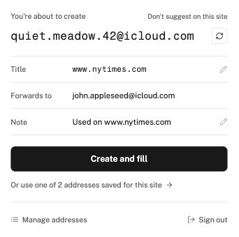
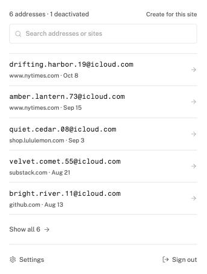

# iCloud Hide My Email Browser Extension

[](https://github.com/dedoussis/icloud-hide-my-email-browser-extension/actions/workflows/tests.yml)

[Hide My Email](https://support.apple.com/en-us/HT210425) is a privacy service that comes with iCloud+. Safari offers to create a Hide My Email address whenever you sign up on a website. This extension brings the same flow to other browsers:

- [Chrome](https://chrome.google.com/webstore/detail/icloud-hide-my-email/omiaekblhgfopjkjnenhahfgcgnbohlk)
- [Firefox](https://addons.mozilla.org/en-US/firefox/addon/icloud-hide-my-email/)
- [Brave](https://chrome.google.com/webstore/detail/icloud-hide-my-email/omiaekblhgfopjkjnenhahfgcgnbohlk)
- Microsoft Edge

It should work on any Chromium-based browser that supports Manifest V3 extensions.

_Disclaimer: This extension is not endorsed by, directly affiliated with, maintained, authorized, or sponsored by Apple._

<p align="center">

&nbsp;&nbsp;

</p>

## Features

- **Preview before you create.** The pop-up shows the new address with an editable title and note. **Create and fill** reserves it and fills it into the page.
- **Reuse addresses.** If you already have addresses for the current site, the pop-up offers them.
- **Manage addresses.** Search all of your addresses, edit the title and note, and deactivate, reactivate, or delete them.
- **Autofill on any site.** A suggestion appears under focused email fields, and the right-click menu works on any text field.
- **Mute sites.** **Don't suggest on this site** turns off the in-page suggestion for one site. You can unmute it from the settings page.
- **Stay signed in.** When your iCloud session expires, the extension tries to renew it by loading icloud.com in a background tab. This only works if you ticked **Keep me signed in** when you signed in to icloud.com.
- **Settings.** Change the forwarding address, turn each autofill method on or off, and manage muted sites.

### Signing in

The extension never asks for your Apple ID password. Sign in to [icloud.com](https://www.icloud.com) in the same browser, including two-factor authentication and **Trust This Browser**. The extension then uses the icloud.com session already stored in your browser. The quickstart guide opens after installation and walks through these steps.

## Build from source

### Prerequisites

- Node.js 25.1, as pinned in `.nvmrc`. If you use nvm, run `nvm use`.
- npm, which ships with Node.js.

Run all commands from the root of this repository.

### Build

1. Install dependencies:

   ```bash
   npm ci
   ```

2. Build the extension for your browser:

   | Browser                                      | Command                 |
   | -------------------------------------------- | ----------------------- |
   | Chrome, Edge, Brave, Opera, Arc, and Vivaldi | `npm run build`         |
   | Firefox                                      | `npm run build:firefox` |

   The build writes the extension to the `build` directory. Always build through `npm run`. The build reads the extension version from `package.json` through npm. Running `node utils/build.js` directly produces a manifest without a version.

### Load the extension into a browser

#### Chrome and other Chromium-based browsers

1. Open the extensions page:

   | Browser | Address               |
   | ------- | --------------------- |
   | Chrome  | `chrome://extensions` |
   | Edge    | `edge://extensions`   |
   | Brave   | `brave://extensions`  |
   | Opera   | `opera://extensions`  |

2. Turn on **Developer mode**.
3. Select **Load unpacked**, then select the `build` directory.
4. Pin the extension to the toolbar so that you can open the pop-up.

After you rebuild, select the reload button on the extension's card.

#### Firefox

1. Open `about:debugging#/runtime/this-firefox`.
2. Select **Load Temporary Add-on**, then select `build/manifest.json`.

Firefox removes temporary add-ons when it restarts. To keep the extension installed, sign the extension through [addons.mozilla.org](https://addons.mozilla.org/developers/).

If you use [Firefox Multi-Account Containers](https://support.mozilla.org/en-US/kb/containers), sign in to icloud.com from a tab outside any container.

#### Safari

Safari is not supported. Safari has a native Hide My Email integration.

## Develop

The extension is written in TypeScript. The pop-up, settings, and quickstart pages are React apps styled with Tailwind CSS.

1. Start the dev server. It rebuilds the `build` directory when you change a file.

   ```bash
   npm run start           # Chromium-based browsers
   npm run start:firefox   # Firefox
   ```

2. Load the `build` directory into your browser, as described in [Load the extension into a browser](#load-the-extension-into-a-browser).

3. Before you push, run the same checks as CI:

   ```bash
   npm run prettier:check
   npm run lint
   npx tsc --noEmit
   ```

## Publish to the Chrome Web Store

### One-time setup

1. Register as a developer in the [Chrome Web Store Developer Dashboard](https://chrome.google.com/webstore/devconsole/). Registration requires a one-time fee and two-step verification on your Google account.
2. If you publish a fork, create a new item. The existing store listing belongs to its owner, and only that account can upload new versions to it.

### Release a version

1. Increase the version in `package.json`. The Chrome Web Store rejects a package whose version is not higher than the published one.

   ```bash
   npm version patch --no-git-tag-version
   ```

2. Build the production package:

   ```bash
   npm run build
   ```

3. Create the zip from inside the `build` directory, so that `manifest.json` is at the root of the archive:

   ```bash
   (cd build && zip -r ../hide-my-email-chrome.zip .)
   ```

   Do not run `zip build.zip ./build/*`. That command puts the files in a `build/` folder inside the archive, and the store rejects it.

4. In the [Developer Dashboard](https://chrome.google.com/webstore/devconsole/), upload the package:

   - **New item:** select **New item** and upload `hide-my-email-chrome.zip`.
   - **Update:** open the item, go to **Package**, and select **Upload new package**.

5. Complete the **Store listing** tab. It needs a description, the 128×128 icon from `src/assets/img/icon-128.png`, and at least one screenshot. Keep the Apple disclaimer in the description. Do not use Apple logos or imply that Apple makes the extension.

6. Complete the **Privacy practices** tab. Describe the single purpose as "Create and manage iCloud Hide My Email addresses and fill them into web forms." Justify each permission:

   | Permission                                           | Justification                                                                                                                |
   | ---------------------------------------------------- | ---------------------------------------------------------------------------------------------------------------------------- |
   | `declarativeNetRequest`                              | Sets the `Origin` and `Referer` headers that iCloud requires on requests to its Hide My Email API.                           |
   | `storage`                                            | Stores settings, muted sites, and the iCloud service URLs for the current session.                                           |
   | `tabs`                                               | Reads the active tab's address to title new addresses, and opens icloud.com in a background tab to renew an expired session. |
   | `contextMenus`                                       | Adds the Hide My Email item to the right-click menu of text fields.                                                          |
   | `webRequest`                                         | Detects sign-in and sign-out on icloud.com so that the extension stays in sync with the browser session.                     |
   | `notifications`                                      | Tells you when the extension is ready after you sign in.                                                                     |
   | Host permissions on `icloud.com` and `icloud.com.cn` | Calls the iCloud Hide My Email API with the browser's existing icloud.com session.                                           |

   For remote code, answer that the extension does not use remote code. All code, including fonts, is bundled in the package. For data usage, declare that the extension handles authentication information: it uses your icloud.com session cookies to call iCloud, and it does not send data anywhere else.

7. Select **Submit for review**. You can choose to publish automatically after approval or to publish manually.

Review can take from a few days to a few weeks. Changes to permissions can take longer.

## Publish to other stores

### Microsoft Edge Add-ons

Edge accepts the same zip as the Chrome Web Store. Upload it in [Microsoft Partner Center](https://partner.microsoft.com/dashboard/microsoftedge/overview).

### Firefox Add-ons (AMO)

1. Build and package for Firefox:

   ```bash
   npm run build:firefox
   npx web-ext build -s build -a dist
   ```

2. Upload the zip from `dist` in the [Firefox Add-on Developer Hub](https://addons.mozilla.org/developers/).
3. AMO asks for the source code because the build output is bundled and minified. Upload an archive of the repository:

   ```bash
   git archive --format=zip -o hide-my-email-source.zip HEAD
   ```

   In the reviewer notes, point to the [Build from source](#build-from-source) section of this README.

If you publish a fork, change the add-on ID in `browser_specific_settings.gecko.id` in `webpack.config.js`. The current ID belongs to the existing AMO listing.
